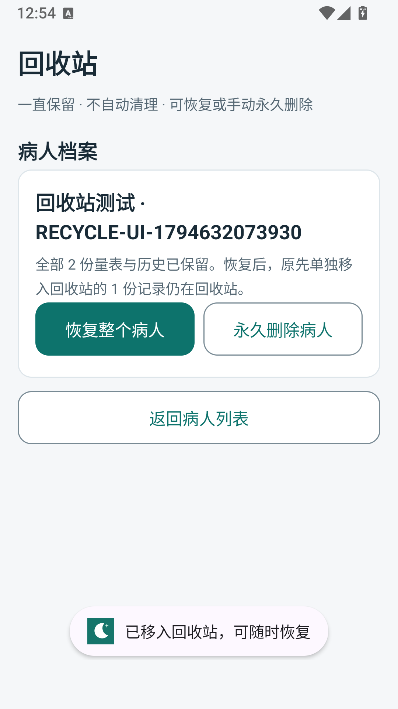
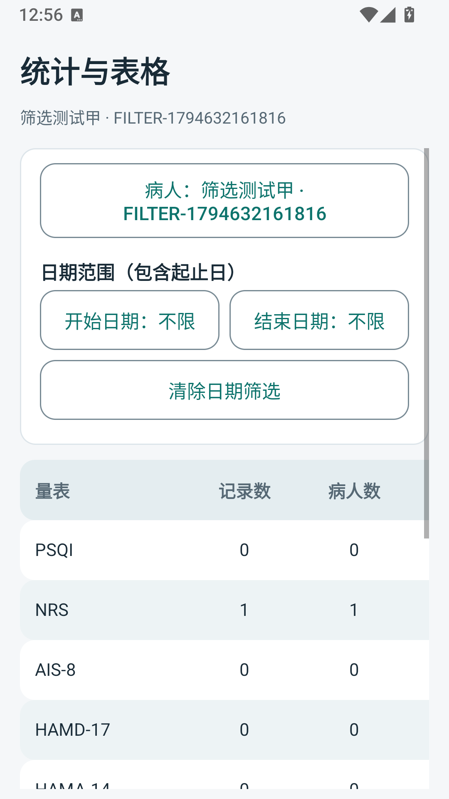

# 睡眠随记 · Sleep Records

Android离线量表记录工具：建立一次病人档案，按日期记录 PSQI、疼痛 NRS、AIS-8、HAMD-17、HAMA-14 和睡眠 NRS，自动保存、计算分数、查看统计并导出表格。

**当前公开版本 v0.0.3** [下载APK](https://github.com/siihihh1191125530/sleep-records/releases/latest) · [更新记录](CHANGELOG.md) · [量表来源](docs/SOURCES.md)

## 功能

- 每位病人独立档案，首次默认显示六份量表，支持添加和移除。新日期沿用该病人最近的选择。
- 每次输入／选择写入本机SQLite事务，保留修改历史；草稿不当作0分。
- 自动计分与描述统计，支持按病人姓名／编号和日期范围筛选。
- 导出Excel（7张工作表）及CSV，沿用当前筛选；完整备份使用`.psqibak`。
- 病人和量表可移入回收站，长期保留、不自动清理；可恢复，只有在回收站再次确认才永久删除。
- 完全离线，无网络权限、无账号、无密码、无云端同步。

| 回收站 | 病人筛选 |
| --- | --- |
|  |  |

截图均为虚拟测试档案，APK不内置任何病人或示例数据库。

## 安装与使用

Android 8.0及以上。下载Release中的APK安装。官方版本与此前个人构建保持包名和签名；0.0.3使用versionCode 10，可覆盖同签名的旧版，**不要先卸载**。

添加病人 → 进入档案 → 记录今天／选择日期 → 填量表 → 完成并查看得分。统计页可选择病人及日期，再导出Excel或CSV。回收站位于“更多”。

“已保存到手机”只表示本机保存。请定期导出完整备份，并复制到自己的电脑或网盘。Excel/CSV不能替代完整备份。备份未加密，包含回收站与修改历史；卸载或清除应用数据会删除本机数据库。

数据库版本为5，完整备份格式为4。使用0.0.3或后续兼容版本可恢复备份中的量表设置。此前已永久删除的信息不会因升级重新出现。

## 量表与适用范围

PSQI/AIS回顾最近1个月，HAMD/HAMA使用最近1周项目窗口，NRS记录当前疼痛；每日填写日期不改变回顾窗口。HAMD/HAMA需由评定者填写。软件只作数据记录和描述统计，不自动给出诊断。

当前中文提示并非全部为已授权、经验证的标准电子译本；PSQI采用既有项目确认的边界与简化条目。正式施测须自行核对原表、适用性和使用条件。详见[来源与实施差异](docs/SOURCES.md)及[第三方权利说明](THIRD_PARTY_NOTICES.md)。

## 构建（Windows / PowerShell）

1. 安装JDK 21，将`java`、`javac`、`jar`和`keytool`加入PATH。
2. 安装Android SDK：`platforms;android-34`、`build-tools;34.0.0`、`platform-tools`；按SDK安装流程接受其许可，将`ANDROID_HOME`设为SDK目录。
3. 运行：

```powershell
./test-core.ps1
./build.ps1
```

脚本自动下载固定版本R8 8.3.37并校验SHA-256，生成`build/sleep-records.apk`。首次本地构建在被Git忽略的`private/`生成个人签名；该签名不能覆盖官方Release。保留自己的签名用于后续升级，勿提交或公开。

维护者可通过`SLEEP_RECORDS_KEYSTORE`及`SLEEP_RECORDS_PASSWORD_FILE`指定既有签名文件。环境变量填写文件路径，不在命令或日志中打印密码。官方签名私钥不在仓库中。

## 测试

纯Java计分与备份测试由`test-core.ps1`运行。模拟器测试需先安装构建APK：

```powershell
adb -s emulator-5554 install -r ./build/sleep-records.apk
./test-device.ps1 -Device emulator-5554 -Mode recycle
```

支持storage、patients、multi、migration、migration2、migration3、recycle、recycle-ui、delete、filter-ui、continuous、ui、verify-kill、result、generic-ui、keyboard、visual。**仅在独立测试设备运行，UI模式会建立虚拟档案，delete/recycle模式包含永久删除测试。所有UI测试串行执行。** 详细检查见[验证记录](docs/TESTING.md)。

## 项目结构

`src/`为原生Java代码；`res/`为Android资源；`tests/`为核心与设备测试；`docs/`为来源、设计及验证说明。不依赖服务器或网页运行环境。

## 开源许可与贡献

软件代码采用[MIT License](LICENSE)，第三方量表及资料适用其各自权利条件，见[第三方说明](THIRD_PARTY_NOTICES.md)。欢迎提交问题和改进，**不要在Issue或PR中上传真实病人资料、数据库、备份或签名文件**。提交时说明复现步骤、设备版本和验证方法。


2026-11-17：新增自定义睡眠NRS、HAMD缺项保存及PSQI题目版本2。新建记录补全第8、9题及选填同伴观察；旧记录保留原题含义。详见docs/UPDATE-0.0.2.md。
